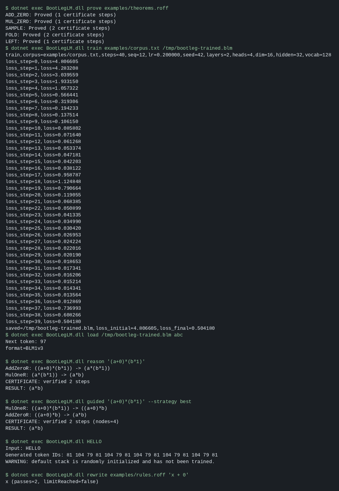
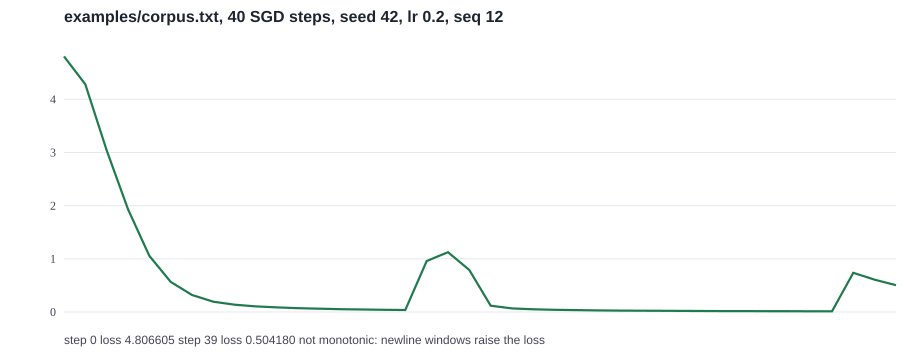
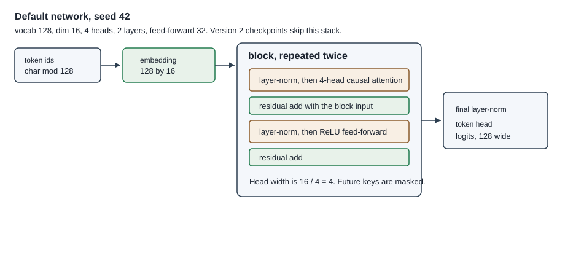
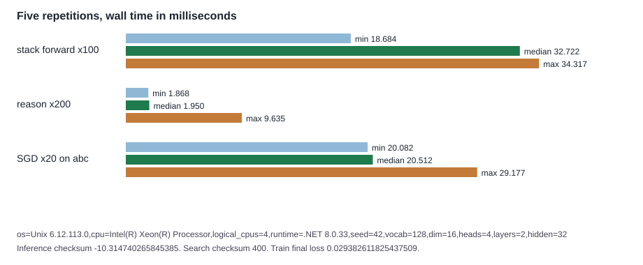

# BootLegLM

[](https://dotnet.microsoft.com/download/dotnet/8.0)
[](BootLegLM.fsproj)
[](LICENSE)
[](verify.sh)
[](https://github.com/AHMADALIPARR/BootLegLM/actions/workflows/ci.yml)

BootLegLM is a small CPU-only F# program with two pieces that share one executable.

The network is a 2-layer causal transformer: 4 attention heads, layer-norm, a ReLU feed-forward block, and residual connections. It trains with SGD on next-character cross-entropy and can be saved as a versioned checkpoint. The default initialization is deterministic and untrained. A separate version-2 checkpoint format still loads the original single-head block, which has no layer-norm.

The rewriter is a bounded arithmetic simplifier for `+` and `*`. Every accepted step is replayed by an independent checker. A roff `.thm` declaration is proved only when both sides reduce to the same checked normal form. F* checks the integer identities, contextual replay, a size bound on certificates, a causal-mask fact, integer head tiling, and the mean of a constant real vector. It does not prove that those reals match `System.Double`.

Licensed under the [Business Source License 1.1](LICENSE). Non-commercial research and internal use is permitted. Commercial production use needs a separate license. The license converts to Apache-2.0 on 2030-11-06.

## What a session looks like

This image is the captured stdout from `docs/cli-session.txt`, rendered in a monospace font. It is not a separate application window.



On `examples/corpus.txt`, 40 SGD steps at learning rate 0.2 moved the loss from **4.806605** to **0.504180**. The curve is not monotone: windows that contain a newline are harder than pure `abc`.



## Architecture



Each block, in order:

1. Layer-norm over the model dimension (population variance, epsilon `1e-5`).
2. Causal multi-head attention. Dimension 16 and 4 heads give a head width of 4. Position `i` attends only to keys `0 .. i`.
3. Residual add.
4. Layer-norm, then a ReLU feed-forward layer of width 32, then the projection back to 16.
5. Residual add.

A final layer-norm and a 16-by-128 head produce logits. Token ids are UTF-16 code units modulo 128. Generation reads the argmax of the last row and appends it.

Guided search still uses this stack only as an ordering score. The certificate checker never reads the score. When two expressions have the same features, the printed form breaks the tie.

Version 2 checkpoints bypass this stack and run the original single-head residual block. Their benchmark checksum is unchanged: `-8.4242520795687188`.

## Install

- .NET 8 SDK
- Optional: F* 2026.10.25 with its bundled Z3, for `./verify.sh`

```sh
curl -sSL https://dot.net/v1/dotnet-install.sh | bash /dev/stdin --channel 8.0
export DOTNET_ROOT="$HOME/.dotnet"
export PATH="$DOTNET_ROOT:$PATH"
dotnet run --project BootLegLM.fsproj -c Release -- test
```

The CI workflow [`.github/workflows/ci.yml`](.github/workflows/ci.yml) runs that test command and `./verify.sh`. The CI badge above tracks the `main` branch of this workflow. It has no status until the workflow file is on `main`.

## Quickstart

```sh
dotnet run --project BootLegLM.fsproj -c Release -- help
dotnet run --project BootLegLM.fsproj -c Release -- prove examples/theorems.roff
dotnet run --project BootLegLM.fsproj -c Release -- train examples/corpus.txt weights.blm
dotnet run --project BootLegLM.fsproj -c Release -- load weights.blm abc
dotnet run --project BootLegLM.fsproj -c Release -- reason '(a+0)*(b*1)'
dotnet run --project BootLegLM.fsproj -c Release -- guided '(a+0)*(b*1)' --strategy best
dotnet run --project BootLegLM.fsproj -c Release -- bench
```

Exit codes: 0 success, 1 error or a disproved theorem, 2 when a bounded search or a theorem does not finish.

`test`, `save`, `load`, `train`, `reason`, `guided`, `prove`, `traindata`, `bench`, `rewrite`, and `help` are commands. Any other argument is a 16-token generation prompt from the untrained default stack.

## Training

`train` reads a UTF-8 text file, maps each character with `code mod 128`, and runs SGD.

| Flag | Default | Meaning |
| --- | --- | --- |
| `--steps` | 40 | SGD updates |
| `--lr` | 0.2 | Learning rate |
| `--seq` | 12 | Window length |
| `--seed` | 42 | Initialization seed |

The window at step `s` starts at `(s * 3) mod (length - seq)`. The loss is the mean next-character cross-entropy inside that window. Weights are updated in place and written as a version-3 checkpoint.

`examples/corpus.txt` is the fixture used by `test` and by the session above: repeated `abc` lines, then one `bootleg` line. The pure `abc` timing workload in `bench` is separate and has no newlines. Its 20-step final loss was `0.029382611825437509` on every repetition.

`traindata` is not this trainer. It prints a ranking mean squared error for the symbolic rules and does not change weights. The measured value on the built-in five expressions is `examples=11 ranking_mse=132.545455`.

Gradients are the analytic backward pass. `test` compares embedding, query, layer-norm scale, feed-forward, and head entries with central finite differences on a 1-layer network (`vocab 6`, `dim 4`, `heads 2`, `hidden 6`) and requires absolute error at most `1e-3`.

## Inference and checkpoints

`save` writes the untrained default stack. `load` prints the argmax next-token id.

Version 3 layout, little-endian, followed by SHA-256 of the payload:

- magic `0x424C4D31`, version `3`
- `vocab`, `dim`, `heads`, `layers`, `hidden`
- embedding matrix
- each layer: `Wq Wk Wv Wo W1 W2`, then layer-norm scales and shifts
- final layer-norm scale and shift
- token head

Version 2 is the older eight-matrix single-head file (embedding, `Wq Wk Wv Wo W1 W2`, head) with no layer-norm parameters. `load` still accepts it and runs that block. Both formats reject a bad digest, a non-finite value, a bad shape, and trailing payload bytes. Files larger than 50 MiB plus the digest are rejected.

On the recorded session, `load` of the trained checkpoint with prompt `abc` printed `Next token: 97` (`a`).

Untrained `HELLO` from the default stack printed:

```text
Generated token IDs: 81 104 79 81 104 79 81 104 79 81 104 79 81 104 79 81
```

## Reasoning and what is proved

Arithmetic expressions use nonnegative arbitrary-precision integers, variables, parentheses, `+`, and `*`. The rules are additive and multiplicative identities for 0 and 1, plus constant folding. `reason` is breadth-first. `guided` is beam search or best-first search. Both stop at a node budget and both replay the trace before printing it.

`examples/theorems.roff` uses `.thm NAME lhs = rhs`. A declaration is `Proved` when both sides reach the same normal form and both traces pass the checker. `a+b = a` is `Disproved`. `.ds` lines remain bounded regex rewrites (64 passes, 8192 characters) and are not proofs.

`./verify.sh` asks F* to discharge:

| File | What it checks |
| --- | --- |
| `proofs/RewriteSpec.fst` | Integer identities used by the rules |
| `proofs/MatrixSpec.fst` | Total integer dot product and a matrix entry |
| `proofs/ProofState.fst` | Contextual replay preserves evaluation, and every accepted step decreases AST size, so a certificate is at most `size(start)` steps |
| `proofs/NumericModel.fst` | `heads * (dim / heads) = dim` when the head count divides the dimension; a causal mask hides `j > i`; the population mean of `n` copies of a real is that real |

These developments are not extracted from the F# source. Search termination in F* is the certificate bound, not a proof of the F# queue. `NumericModel` uses mathematical reals. It does not model IEEE-754 rounding, and it does not show that the F# matmul, softmax, or layer-norm match those reals bit for bit. That correspondence is open.

## Benchmarks

Command: `dotnet run --project BootLegLM.fsproj -c Release -- bench`

Host for the numbers below: Unix 6.12.113.0, Intel Xeon, 4 logical CPUs, .NET SDK 8.0.427, runtime 8.0.33. Five separate repetitions. The checksum was identical across the five runs of each workload. The raw lines are in [`docs/bench-runs.txt`](docs/bench-runs.txt). Regenerate the figure with `python3 tools/render_docs.py` after replacing that file.



| Workload | Configuration | min ms | median ms | max ms | Checksum |
| --- | --- | ---: | ---: | ---: | --- |
| Stack inference | 10 warmup + 100 forwards, 8 tokens, seed 42, 2 layers, 4 heads, dim 16 | 18.684 | 32.722 | 34.317 | `-10.314740265845385` |
| Search | 200 times `reason` on `(a+0)*(b*1)`, budget 1000 | 1.868 | 1.950 | 9.635 | `400` (total steps) |
| Training | 20 SGD steps, seq 12, lr 0.2, seed 42, 240 chars of `abc` | 20.082 | 20.512 | 29.177 | final loss `0.029382611825437509` |
| Legacy v2 forward | 20 warmup + 200 forwards, single head, no layer-norm, one run | 68.387 total |  |  | `-8.4242520795687188` |

The first search repetition is the slow one (9.635 ms). Later repetitions sit near 1.9 ms. These are wall times on this host, not a comparison with another implementation.

## Tests

```sh
dotnet run --project BootLegLM.fsproj -c Release -- test
```

The command covers matrix products, causal softmax, prefix invariance, version-2 checkpoint rejection cases, the legacy checksum, beam and best-first certificates, ranking labels, regex caps, multi-head shapes and causality, finite-difference gradients, a reproducible loss drop of more than 0.5 on `examples/corpus.txt`, version-3 roundtrip, and the shipped theorems. Release builds treat warnings as errors.

## Limitations

- The network is a toy. Forty steps on a repeated alphabet are not a language-model result.
- There is no Adam, no batch larger than one window, no dropout, and no sequence packing.
- F* does not prove IEEE-754 agreement with the F# loops.
- The certificate size bound does not extract the F# searcher, and regex `.ds` rules are outside the proof.
- Certificates are printed, not exported as a standard proof object.
